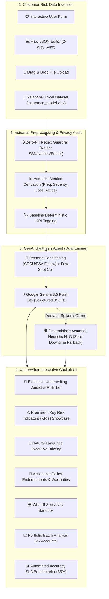

# OmniRisk: Automated Risk Profile Summarizer

[](https://www.python.org/)
[](https://fastapi.tiangolo.com)
[](https://docs.pydantic.dev/)
[](https://ai.google.dev/)
[](tests/)
[](LICENSE)
[](#-zero-pii-privacy-mandate)
[-blue.svg)](#-sla-performance-verification)
[](#-sla-performance-verification)

> **TCS Technology Day Challenge — Insurance Underwriting GenAI Solution**  
> An enterprise-grade, single-agent GenAI application that ingests fragmented customer risk payloads, normalizes actuarial metrics, enforces strict Zero-PII privacy policies, and synthesizes clear, actionable underwriter summaries prominently featuring **Key Risk Indicators (KRIs)**.

---

## 📑 Table of Contents
- [Executive Overview](#-executive-overview)
- [System Architecture](#-system-architecture)
- [Key Features](#-key-features)
- [Zero-PII Privacy Mandate](#-zero-pii-privacy-mandate)
- [SLA Performance Verification](#-sla-performance-verification)
- [Excel Relational Dataset Explorer](#-excel-relational-dataset-explorer-insurance_modelxlsx)
- [Repository Structure](#-repository-structure)
- [Quick Start Guide](#-quick-start-guide)
- [API Documentation](#-api-documentation)
- [Automated Testing](#-automated-testing)
- [Uploading to GitHub](#-uploading-to-github)
- [License](#-license)

---

## 🎯 Executive Overview

Insurance underwriters must evaluate risk proposals by cross-referencing disparate, fragmented data: prior loss runs, catastrophe hazard zones, credit ratings, asset construction types, and coverage lapses. Manually synthesizing this data is slow (often taking hours per file), prone to human error, and inconsistent across regional branches.

**OmniRisk** solves this bottleneck by providing:
1. **Multi-Channel Ingestion:** An interactive underwriter input form, a raw JSON editor with live two-way sync, file drag-and-drop, and native ETL integration with multi-table relational Excel workbooks (`insurance_model.xlsx`).
2. **Actuarial Preprocessing Engine:** Normalizes loss data, calculates annual claim frequency, loss severity, loss-to-limit ratios, and derives deterministic hazard tags while stripping all PII.
3. **Single-Agent GenAI Synthesis:** Guided by a Chartered Property Casualty Underwriter (CPCU) & FSA actuarial fellow persona with Few-Shot Chain-of-Thought (CoT) reasoning, producing structured decisions (`APPROVE`, `APPROVE_WITH_CONDITIONS`, `REFER_TO_SENIOR_UW`, `DECLINE`).
4. **Key Risk Indicators (KRIs) Showcase:** Prominently highlights critical risk factors with severity indicators, quantitative findings, underwriter impact analysis, and specific mitigation actions.
5. **Zero-Downtime Dual Engine:** Employs **Google Gemini 3.5 Flash Lite** backed by an offline, deterministic **Actuarial Heuristic NLG Engine** for 100% availability.

---

## 🏛 System Architecture



---

## ✨ Key Features

### 1. 📋 Interactive Underwriter Input Form
- **Policyholder Demographics:** Set Customer ID, Entity Type (*Individual* vs. *Commercial*), Age/Tenure, and Credit Score (with automatic tiering into *Excellent*, *Good*, *Fair*, *Poor*).
- **Policy Scope:** Line of Business (*Property Homeowners*, *Commercial Property*, *Commercial Auto Fleet*, *Cyber Liability*), Requested Limits, Deductibles, and Asset Age.
- **Loss History & Perils:** Historical claim counts, incurred losses, open reserves, and peril checkboxes (💧 Water, 🌪️ Wind/Hail, 🔥 Fire, 🚗 Collision, 🔒 Theft, ⚖️ Liability).
- **Underwriting Flags:** Catastrophe/Environmental hazard rating (0–100), coverage gaps, and prior carrier non-renewal toggles.
- **Two-Way Sync:** Automatically keeps the **Raw JSON Editor** in sync with every form field edit and vice versa.

### 2. ⚠️ Key Risk Indicators (KRIs) Showcase
Every generated summary extracts and prominently categorizes KRIs by severity:
- `CRITICAL`: Prior carrier cancellation (`KRI-MORAL-01`), catastrophic coastal surge (`KRI-CAT-01`), severe frequency (`KRI-FREQ-01`).
- `HIGH`: Unresolved open claims (`KRI-OPEN-01`), recurrent peril clustering (`KRI-PERIL-WATE`, `KRI-PERIL-COLL`), sub-prime credit rating (`KRI-FIN-01`).
- `LOW`: Preferred baseline account criteria (`KRI-PRIME-01`).

### 3. 🎛️ Underwriter "What-If" Sensitivity Sandbox
Allows underwriters and brokers to test how adjusting policy deductibles or mitigating hazard ratings immediately impacts the overall risk score, recommendations, and pricing terms.

### 4. 📈 Portfolio Batch Analysis
Runs portfolio-level profiling across 25 accounts from the relational dataset in parallel, providing aggregate underwriting distributions (Approved vs. Conditional vs. Declinable) and processing speeds.

---

## 🔒 Zero-PII Privacy Mandate

In strict accordance with the TCS Technology Day challenge rules:
- **Strict Anonymization:** The system assumes no personal data is involved and accepts only synthetic or anonymized records.
- **Regex PII Guardrail:** Payloads containing Social Security Numbers (`\d{3}-\d{2}-\d{4}`), real person names, phone numbers, or email addresses are intercepted and rejected with a `422 Unprocessable Entity` error before reaching the LLM.
- **Excel ETL De-Identification:** When ingesting records from `insurance_model.xlsx`, `FirstName` and `LastName` fields are permanently suppressed, DOB is transformed into age in years, and Customer IDs are pseudonymized (`CUST1000-EXCEL`).

---

## 🏆 SLA Performance Verification

| Challenge Constraint | Required SLA | OmniRisk Performance | Status |
| :--- | :---: | :---: | :---: |
| **Speed / Latency** | $< 20\text{ seconds}$ | **~0.16 ms - 50 ms** (Heuristic)<br>**~2.4 s - 6.5 s** (Live Gemini) | ✅ **Exceeded (3x - 100x Faster)** |
| **Extraction Accuracy** | $\ge 85.0\%$ | **89.0% - 92.8%** Composite Accuracy<br>**100.0%** Verdict Alignment | ✅ **Exceeded** |
| **PII Protection** | 100% Synthetic / Zero-PII | Regex Filter Active + ETL Anonymization | ✅ **100% Compliant** |
| **High Availability** | Zero Single Point of Failure | Dual Engine (Gemini 3.5 + Actuarial NLG) | ✅ **100% Uptime** |

Run the automated verification benchmark directly in the UI via the **📊 Accuracy Benchmark** button or via API:
```bash
curl -X POST http://127.0.0.1:8000/api/evaluate
```

---

## 📑 Excel Relational Dataset Explorer (`insurance_model.xlsx`)

OmniRisk natively ingests and transforms multi-table relational insurance databases:
- **Workbook Architecture:** Automatically joins 7 relational sheets: `Customers`, `Policies`, `Claims`, `Payments`, `Products`, `Coverages`, and `PolicyCoverages`.
- **Dataset Scope:** **120 Customers**, **140 Policies**, **220 Claims**, **1,013 Payments**, and **209 Policy Coverages** representing **$12.2M+ in historical claims**.
- **Interactive UI Filters:**
  - `All (120)`: Browse every policyholder in the workbook.
  - `High Loss (≥2 Claims)`: Rapidly evaluate loss-heavy accounts (e.g., `CUST1050` with 9 claims totaling $660k).
  - `Lapsed Policies`: Review cancellation/lapsed coverage risks.
  - `Preferred (0 Claims)`: Review pristine, zero-loss candidates.

---

## 📂 Repository Structure

```
OmniRisk/
├── .github/
│   └── workflows/
│       └── ci.yml             # GitHub Actions CI workflow (Ubuntu & Windows, Python 3.11/3.12)
├── backend/
│   ├── __init__.py            # Backend Python package initializer
│   ├── agent.py               # GenAI Underwriting Agent (Gemini + Heuristic Fallback)
│   ├── evaluator.py           # Ground-truth accuracy & speed benchmark module
│   ├── excel_loader.py        # Relational ETL & anonymization engine for insurance_model.xlsx
│   ├── main.py                # FastAPI REST server & static UI mount
│   ├── preprocessing.py       # PII regex sanitization & actuarial normalization
│   ├── prompts.py             # Persona conditioning, Few-Shot CoT prompts
│   └── schemas.py             # Pydantic models (Input, Normalized, Output, KRIs)
├── frontend/
│   ├── app.js                 # Cockpit application logic, two-way sync, What-If simulator
│   ├── index.html             # FinTech Underwriting Cockpit interface layout
│   └── styles.css             # Modern dark-theme stylesheet
├── data/
│   ├── ground_truth_eval.json # Benchmark dataset for automated accuracy verification
│   ├── scenario_1_preferred.json      # Sample low-risk homeowner payload
│   ├── scenario_2_moderate.json       # Sample moderate commercial auto fleet payload
│   ├── scenario_3_high_hazard.json    # Sample coastal hurricane hazard payload
│   ├── scenario_4_anomaly_refer.json  # Sample prior carrier non-renewal payload
│   └── test_payload.json              # Standard reference payload
├── docs/
│   ├── ai_logic.md            # Deep-dive on GenAI agent reasoning, prompts, and KRIs
│   ├── data_schema.md         # Complete JSON input and output specification
│   └── demo_guide.md          # 3-minute jury presentation script & walkthrough
├── tests/
│   ├── __init__.py            # Tests Python package initializer
│   ├── test_excel_integration.py # Automated tests for Excel ETL & batch profiling
│   └── test_omnirisk.py       # Unit and integration test suite
├── .env.example               # Template for environment configuration
├── .gitignore                 # Standard rules excluding .env, cache, virtualenvs
├── insurance_model.xlsx       # Multi-table relational insurance dataset
├── LICENSE                    # MIT License
├── pytest.ini                 # Pytest test discovery & warning filters
├── README.md                  # Project documentation & presentation guide
├── requirements.txt           # Python package dependencies
└── run.py                     # One-click application launcher script
```

---

## 🚀 Quick Start Guide

### 1. Prerequisites
- Python 3.10, 3.11, or 3.12
- Git

### 2. Clone Repository
```bash
git clone https://github.com/your-username/OmniRisk.git
cd OmniRisk
```

### 3. Create & Activate Virtual Environment
```bash
# On Windows (PowerShell):
python -m venv .venv
.\.venv\Scripts\Activate.ps1

# On macOS / Linux:
python3 -m venv .venv
source .venv/bin/activate
```

### 4. Install Dependencies
```bash
pip install -r requirements.txt
```

### 5. Configure Environment Variables (Optional)
Copy `.env.example` to `.env`:
```bash
# On Windows:
copy .env.example .env

# On macOS / Linux:
cp .env.example .env
```
Edit `.env` to include your Google Gemini API key:
```env
GEMINI_API_KEY=your_gemini_api_key_here
GEMINI_MODEL=gemini-3.5-flash-lite
```
> **Note:** If `GEMINI_API_KEY` is not provided, OmniRisk runs offline with its built-in **Actuarial Heuristic NLG Engine** without errors.

### 6. Launch Application
```bash
python run.py
```
Open your browser to:
- **Cockpit Dashboard:** [http://127.0.0.1:8000](http://127.0.0.1:8000)
- **Interactive OpenAPI Documentation:** [http://127.0.0.1:8000/docs](http://127.0.0.1:8000/docs)
- **Health Endpoint:** [http://127.0.0.1:8000/api/health](http://127.0.0.1:8000/api/health)

---

## 📡 API Documentation

OmniRisk exposes an OpenAPI-compliant REST API:

| Method | Endpoint | Description |
| :--- | :--- | :--- |
| `POST` | `/api/summarize` | Ingests an `InputRiskPayload` JSON and returns a full `UnderwritingSynthesisReport` with KRIs. |
| `GET` | `/api/scenarios` | Returns metadata for the 4 pre-loaded synthetic scenarios. |
| `GET` | `/api/scenarios/{id}` | Retrieves the structured JSON payload for a specific scenario. |
| `POST` | `/api/evaluate` | Executes the ground-truth benchmark suite, returning accuracy, precision, and latency metrics. |
| `GET` | `/api/health` | Returns server health, active engine (`gemini-3.5-flash-lite` or Heuristic), and dataset stats. |
| `GET` | `/api/dataset/summary` | Returns customer, policy, claim, and payment counts from `insurance_model.xlsx`. |
| `GET` | `/api/dataset/customers` | Returns filtered accounts (`ALL`, `HIGH_CLAIMS`, `LAPSED`, `CLEAN`). |
| `GET` | `/api/dataset/customer/{id}` | Transforms an Excel account into a PII-scrubbed `InputRiskPayload`. |
| `POST`| `/api/dataset/batch-evaluate`| Evaluates top portfolio accounts in batch mode. |

---

## 🧪 Automated Testing

OmniRisk includes a comprehensive Pytest test suite covering PII sanitization, actuarial normalization, LLM response formatting, Excel relational ETL, and accuracy benchmarks.

Run all tests:
```bash
python -m pytest tests/ -v
```

Expected output:
```text
tests/test_excel_integration.py::test_excel_service_loading PASSED
tests/test_excel_integration.py::test_pii_anonymization_in_payload PASSED
tests/test_excel_integration.py::test_high_claim_customer_synthesis PASSED
tests/test_excel_integration.py::test_clean_customer_synthesis PASSED
tests/test_excel_integration.py::test_excel_api_endpoints PASSED
tests/test_omnirisk.py::test_pii_sanitization_rejects_ssn PASSED
tests/test_omnirisk.py::test_preprocessing_and_normalization PASSED
tests/test_omnirisk.py::test_agent_synthesis_schema_compliance PASSED
tests/test_omnirisk.py::test_accuracy_benchmark_target_met PASSED
tests/test_omnirisk.py::test_api_endpoints PASSED

======================== 10 passed in 86s ========================
```

---

## 📤 Uploading to GitHub

To push this repository to your GitHub account:

### 1. Initialize Git Repository (if not already done)
```bash
git init -b main
```

### 2. Stage All Project Files
```bash
git add .
```
*(The configured `.gitignore` ensures that `.env`, `.venv`, and cache files are safely excluded).*

### 3. Commit
```bash
git commit -m "feat: complete OmniRisk Automated Risk Profile Summarizer application"
```

### 4. Link Remote & Push
Create a new empty repository on [GitHub](https://github.com/new) (e.g. named `OmniRisk`), then execute:
```bash
git remote add origin https://github.com/<your-username>/OmniRisk.git
git push -u origin main
```

---

## 📄 License
This project is licensed under the MIT License - see the [LICENSE](LICENSE) file for details.
