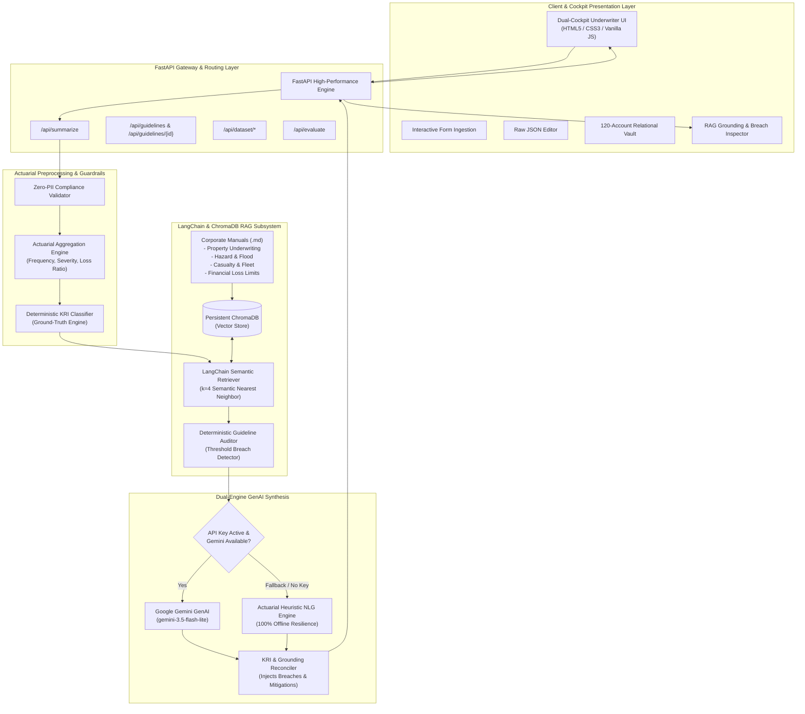
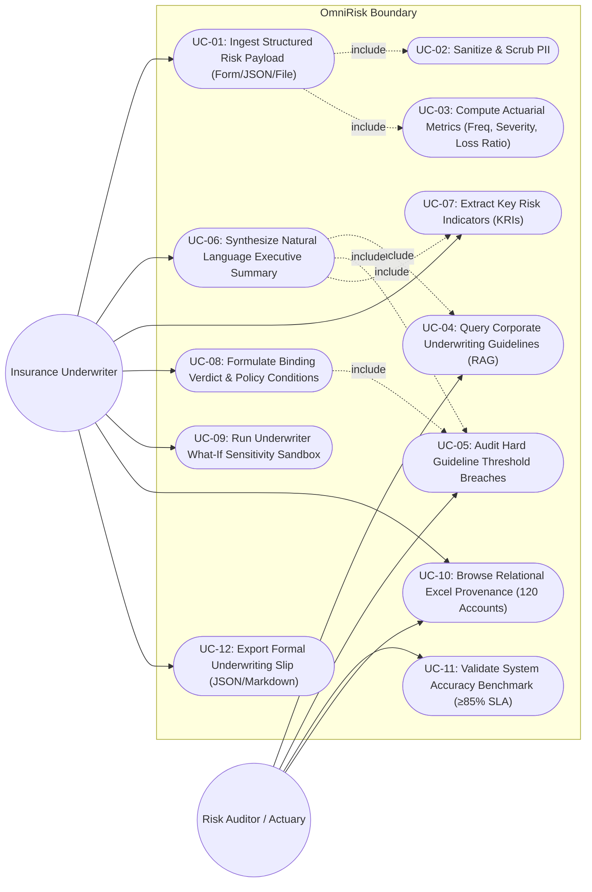
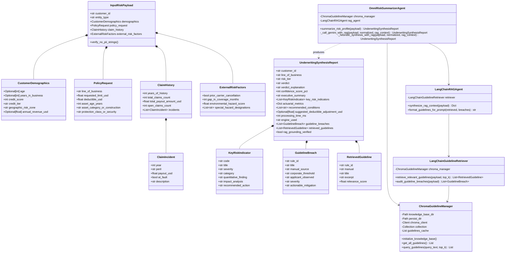
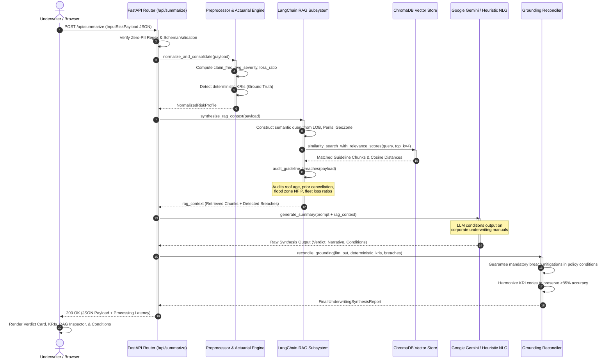
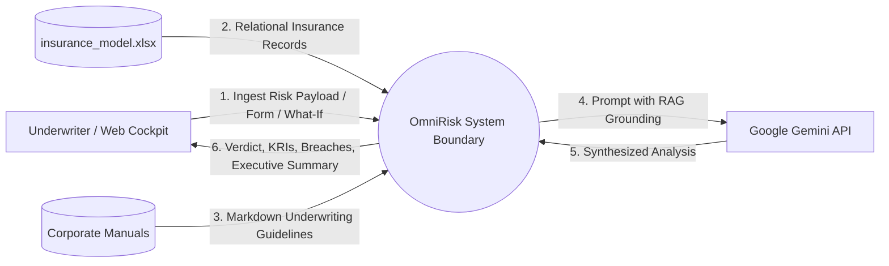
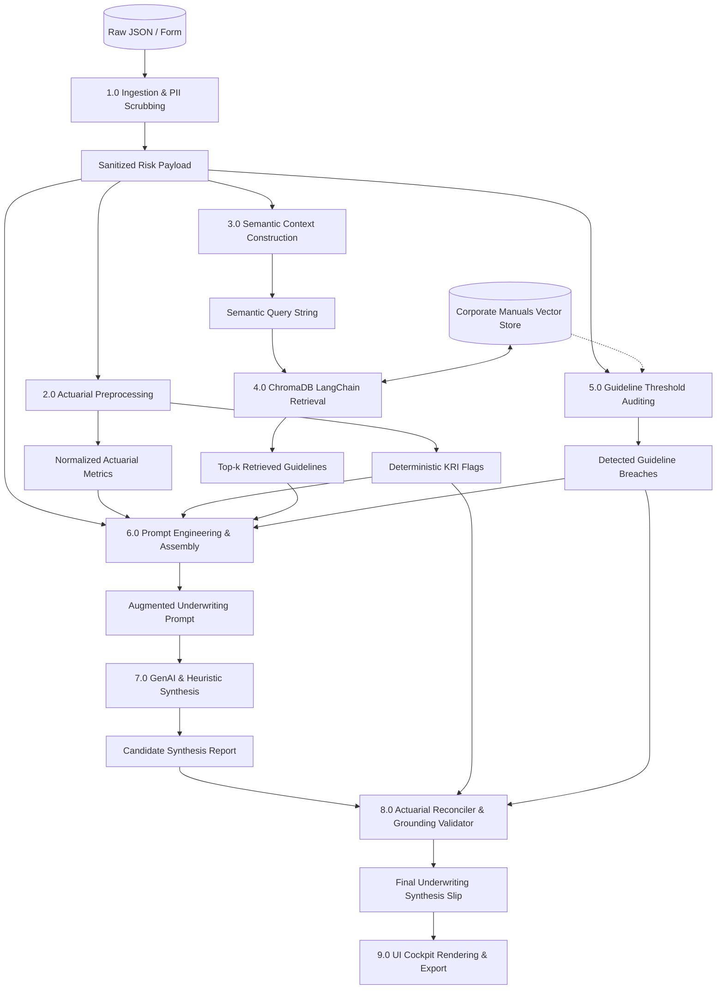
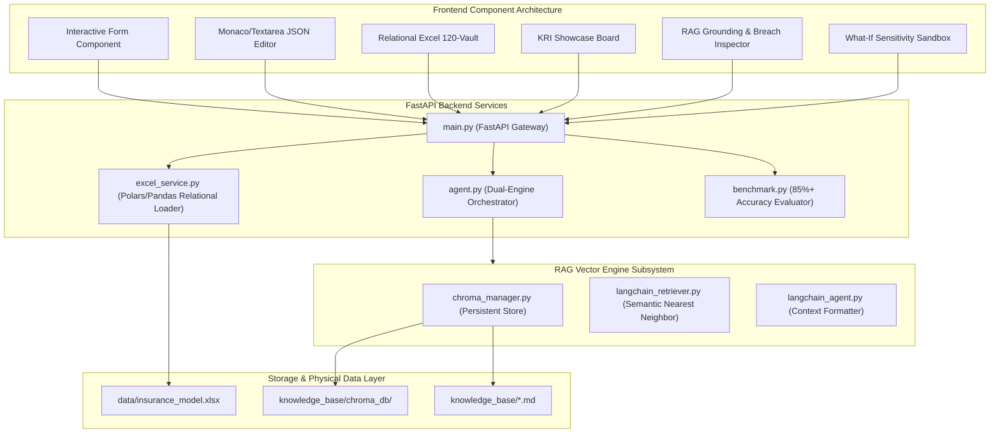

# OmniRisk System Architecture & UML Design Specifications
## Automated Property & Casualty Risk Assessment and Profile Summarization using RAG
**Visvesvaraya Technological University (VTU), Belagavi**  
**Department of Computer Science & Engineering | JNNCE Shivamogga**  
**Batch A13** | **Academic Year 2025–2026**

---

## 1. System Context & Architecture Overview

The OmniRisk system architecture integrates structured risk ingestion, deterministic actuarial preprocessing, persistent vector retrieval via LangChain and ChromaDB, and a resilient dual-engine Large Language Model (Google Gemini with Heuristic NLG fallback).

---

## 2. Use Case Diagram

The Use Case model defines the functional interactions between the Underwriter / Actuarial Auditor (Primary Actor), the Corporate Risk Management System, and the OmniRisk Automated Summarizer.

---

## 3. Class Diagram

The Class Diagram highlights the domain entities, Pydantic data schemas, RAG vector database management classes, and the GenAI synthesis engine.

---

## 4. Sequence Diagram: End-to-End Underwriting Risk Synthesis

This sequence diagram depicts the chronological message exchange from UI payload submission to vector search, rule breach auditing, and GenAI grounding.

---

## 5. Data Flow Diagram (DFD)

### Level 0: Context Diagram

### Level 1: Detailed Data Flow Diagram

---

## 6. Component Architecture Diagram

